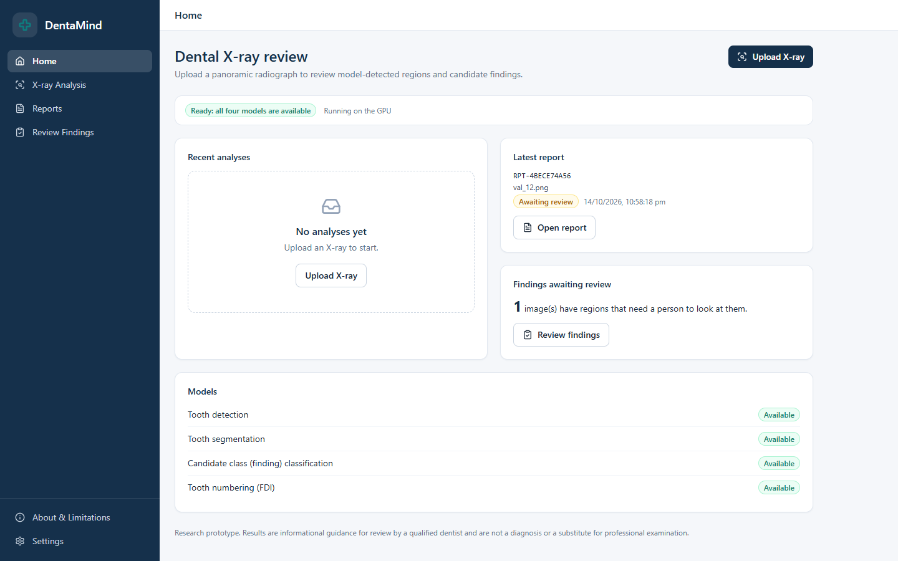
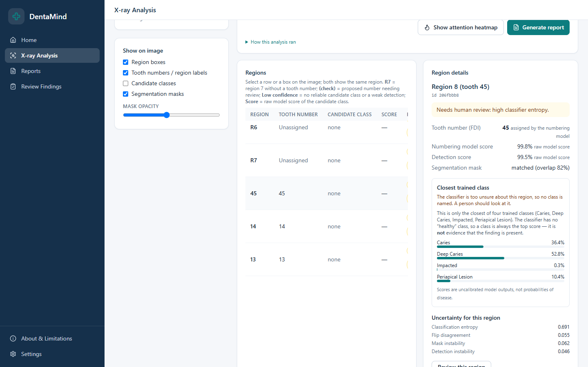
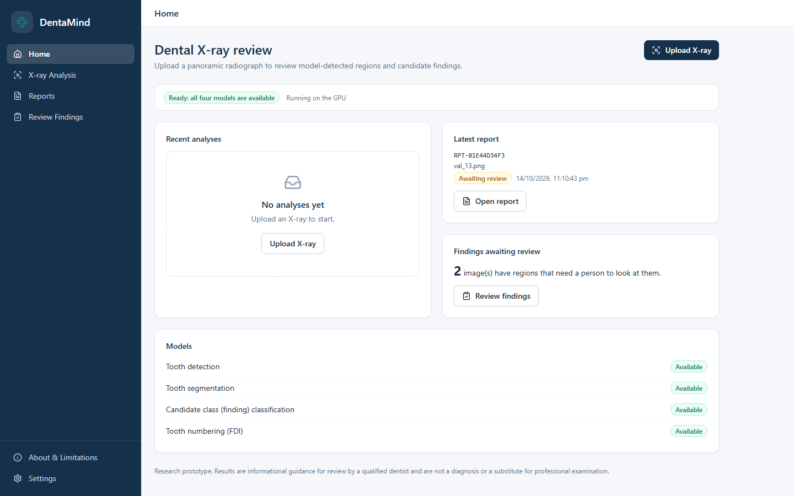
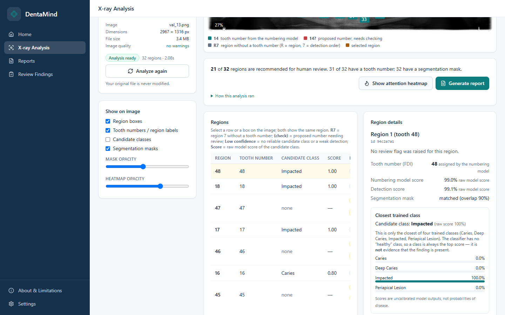
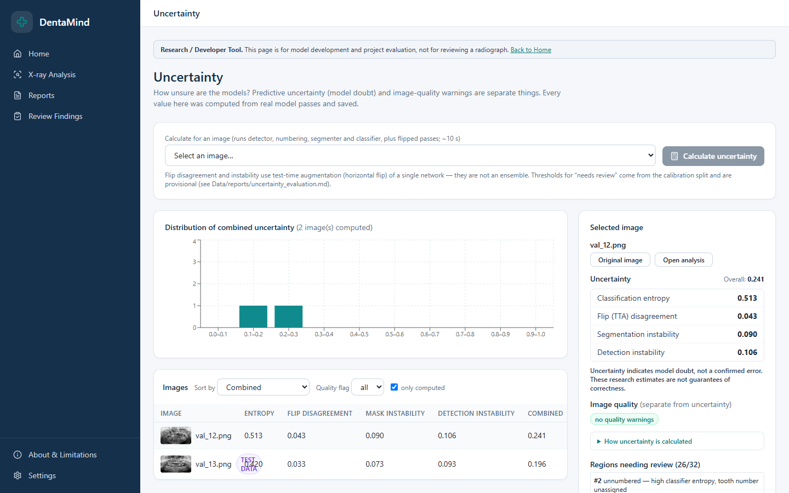
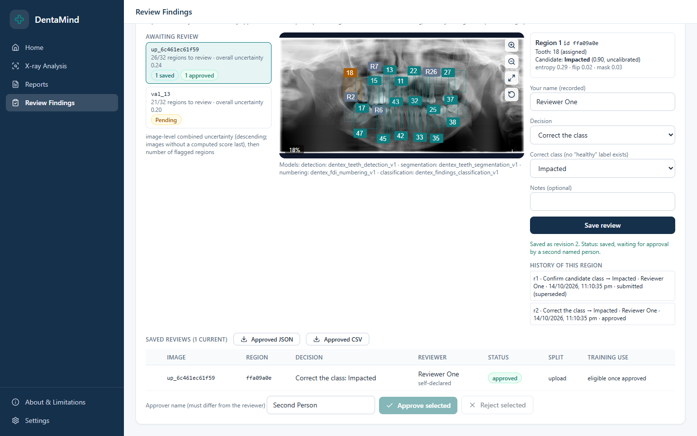
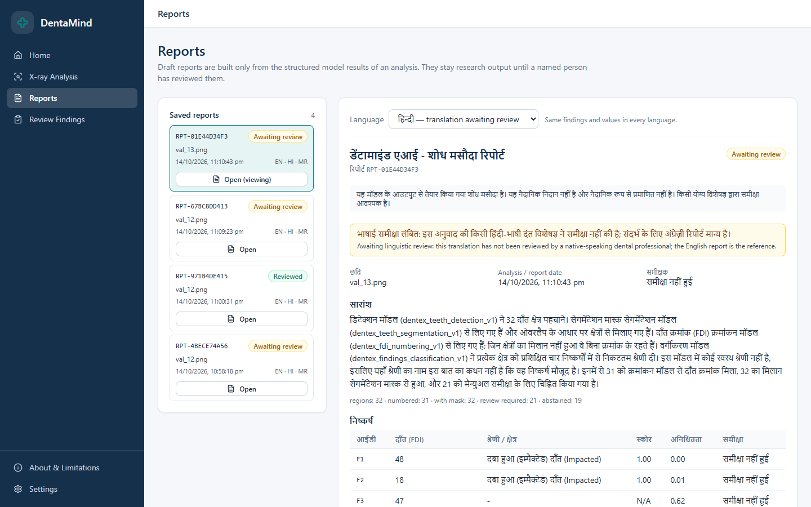
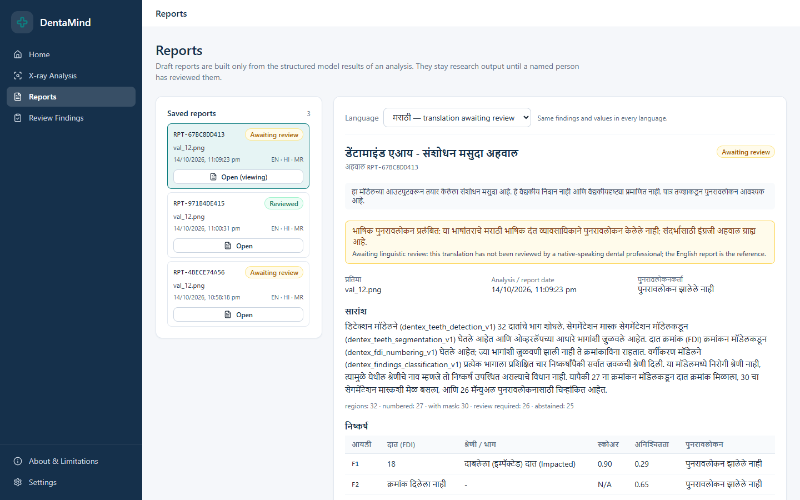

# Dental X-Rays — Gen AI Project

**DentaMind AI** — an explainable panoramic dental X-ray analysis system with uncertainty-aware review,
uncertainty-guided active learning and evidence-grounded report generation.

> **Research prototype.** Nothing this system produces is a diagnosis, and it has not been clinically validated.
> Every generated report is an *unconfirmed research draft* until a named reviewer signs it off.

<p float="left">
  
  
</p>

---

## Table of contents

- [Overview](#overview)
- [Problem statement](#problem-statement)
- [Key features](#key-features)
- [How the system works](#how-the-system-works)
- [AI/ML architecture](#aiml-architecture)
- [Generative AI report pipeline](#generative-ai-report-pipeline)
- [Technology stack](#technology-stack)
- [Project structure](#project-structure)
- [Installation](#installation)
- [Environment variables](#environment-variables)
- [Running locally](#running-locally)
- [Usage](#usage)
- [Screenshots](#screenshots)
- [API](#api)
- [Models](#models)
- [Dataset](#dataset)
- [Testing](#testing)
- [Security considerations](#security-considerations)
- [Limitations and future improvements](#limitations-and-future-improvements)
- [Contributors](#contributors)
- [License and acknowledgements](#license-and-acknowledgements)

---

## Overview

DentaMind AI analyses panoramic dental radiographs end to end: it detects and segments teeth, assigns FDI tooth numbers,
classifies findings per tooth, measures how uncertain each prediction is, and turns the validated structured output into a
written report in **English, Hindi or Marathi**. Uncertain regions are flagged for human review instead of being reported
with false confidence, and reviewer decisions are recorded with an audit history.

The project consists of a Python core library (`src/dentexmodel/`), a FastAPI backend (`backend/`), a React web
application (`frontend/`), training/evaluation scripts (`scripts/`, `kaggle/`) and a test suite (`tests/`).

## Problem statement

Reading panoramic radiographs is time-consuming, and automated tools that output a single confident label hide the cases
where the model is unsure. Labelled dental data is also scarce and expensive to annotate. This project explores:

1. Detecting, numbering and classifying findings on panoramic X-rays with standard deep-learning models.
2. Making uncertainty explicit, so low-confidence regions are abstained on and routed to a human reviewer.
3. Using that uncertainty to choose which images to annotate next (active learning).
4. Generating readable reports that are strictly grounded in the model's validated findings, never free-form diagnosis.

## Key features

- **Tooth detection and segmentation** — Faster R-CNN and Mask R-CNN (ResNet-50 FPN backbones, torchvision).
- **FDI tooth numbering** — 32-tooth FDI numbering derived from detections, registered only after passing a validation gate.
- **Finding classification** — ResNet-50 classifier on per-tooth crops for the DENTEX finding classes
  (Caries, Deep Caries, Impacted, Periapical Lesion).
- **Uncertainty estimation** — predictive entropy, flip-test disagreement and mask/detection instability, plus temperature
  scaling and calibration utilities.
- **Abstention** — high-uncertainty regions are withheld from the final result and sent to review.
- **Human review workflow** — per-region approve/reject with audit history; reports require reviewer sign-off.
- **Active learning** — pool scoring and uncertainty-based vs. random acquisition experiments.
- **Multilingual reports** — English, Hindi and Marathi reports from deterministic templates, with an optional
  LLM rewriting step that is validated against the evidence.
- **Annotation integration** — Label Studio import/export for annotation rounds.
- **Training and experiment management** — start/stop training jobs, model registry with promotion/rollback, experiment
  comparison and export.
- **Research integrity tooling** — grouped (pixel-content) splits, leakage checks, a gated test-set ledger, and 5-fold
  cross-validation tooling.

## How the system works

```
 Upload X-ray ──► Validate & preprocess ──► Tooth detection (Faster R-CNN)
                                                 │
                                                 ├──► Tooth segmentation (Mask R-CNN)
                                                 ├──► FDI numbering
                                                 └──► Per-tooth crops ──► Finding classifier (ResNet-50)
                                                                               │
                                     Uncertainty signals (entropy, flip, instability)
                                                                               │
                                          Abstention rules ──► Final structured result
                                                                               │
                         Human region review ◄──────────────────────────────────┤
                                                                               ▼
                         Report: template (default) or LLM rewrite ──► evidence validation ──► reviewer sign-off ──► export
```

1. **Dataset pipeline** (`scripts/run_pipeline.py`): discover → validate → manifest → grouped splits → quality statistics.
2. **Inference** (`src/dentexmodel/inference/`): loads registered checkpoints (with hash-verified JSON sidecars), runs
   detection, segmentation, numbering and classification, and renders overlays.
3. **Uncertainty and abstention** (`src/dentexmodel/uncertainty/`): computes per-region uncertainty and applies the
   abstention rules.
4. **Reporting** (`src/dentexmodel/reporting/`): builds the final result and the multilingual report.
5. **Review** (`backend/services/reviews.py`): stores reviewer decisions and report validation/sign-off.

## AI/ML architecture

| Task | Model | Framework |
|---|---|---|
| Tooth detection | `fasterrcnn_resnet50_fpn` | PyTorch / torchvision |
| Tooth instance segmentation | `maskrcnn_resnet50_fpn` | PyTorch / torchvision |
| Finding classification | `resnet50` (per-tooth crops) | PyTorch / torchvision |
| Tooth numbering | FDI numbering from detections (`inference/tooth_numbering.py`) | Python |

Architectures and active checkpoints are configured in [`configs/models.yaml`](configs/models.yaml). Training code is in
`src/dentexmodel/training/` (local) and `kaggle/` (GPU runs on Kaggle, including class-imbalance experiments and 5-fold
cross-validation).

## Generative AI report pipeline

Reports are generated from **validated structured findings only** — there is no retrieval/vector-store (RAG) component.

1. Evidence is collected from the stored analysis (regions, FDI numbers, classes, confidences, uncertainty flags).
2. **Template mode (default):** a deterministic, offline template renders the report in English, Hindi or Marathi.
3. **LLM mode (optional):** if `LLM_BASE_URL`, `LLM_API_KEY` and `LLM_MODEL` are set, an OpenAI-compatible
   `/chat/completions` endpoint rewrites the findings (temperature 0, JSON output). Only de-identified structured findings
   are sent.
4. **Validation:** the LLM output is checked against the evidence (classes, confidences) and a list of forbidden clinical
   phrases (e.g. "diagnosis", "treatment plan"). If validation fails, the template report is used instead.
5. Every report carries a disclaimer and remains a draft until a reviewer validates it.

Settings: [`configs/reporting.yaml`](configs/reporting.yaml). Details: [`docs/MULTILINGUAL_REPORTS.md`](docs/MULTILINGUAL_REPORTS.md).

## Technology stack

| Layer | Technologies |
|---|---|
| **Frontend** | React 18, Vite 5, React Router 6, Tailwind CSS 3, Recharts, lucide-react |
| **Backend** | Python, FastAPI, Uvicorn, Pydantic v2, python-multipart |
| **Database** | SQLite (`runtime/dentamind.sqlite3` by default) |
| **ML / AI** | PyTorch, torchvision, NumPy, Pillow |
| **Generative AI** | Optional OpenAI-compatible LLM endpoint (configurable) |
| **Annotation** | Label Studio |
| **Experiment tracking** | TensorBoard (optional) |
| **DevOps** | Docker, Docker Compose, Nginx (frontend container) |
| **Testing** | pytest, unittest, Node test runner |

## Project structure

```
.
├── backend/                 FastAPI application
│   ├── api/                 Routers: images, inference, reports, reviews, training, experiments, active learning, annotations, health
│   ├── services/            Business logic (analysis, pipeline, reports, reviews, training, ...)
│   ├── schemas/             Pydantic models
│   ├── security.py          Token authentication and rate limiting
│   └── main.py              App entry point
├── frontend/                React + Vite web application
│   └── src/                 pages/, components/, hooks/, lib/, services/
├── src/dentexmodel/         Core library
│   ├── data/                Discovery, validation, manifests, splits, leakage checks, FDI, preprocessing
│   ├── inference/           Model registry, promotion, inference system, tooth numbering, visualisation
│   ├── training/            Trainers, jobs, provenance
│   ├── uncertainty/         Measures, calibration, temperature scaling, abstention
│   ├── active_learning/     Acquisition strategies
│   ├── annotation/          Label Studio integration, reviews
│   ├── reporting/           Final result, multilingual reports (i18n)
│   └── evaluation/          Metrics, test-set ledger
├── configs/                 YAML configuration (data, models, reporting, active learning)
├── scripts/                 Pipeline, training, evaluation, audits; scripts/windows/ for PowerShell setup
├── kaggle/                  Kaggle GPU training and 5-fold cross-validation tooling
├── tests/                   Unit and integration tests
├── notebooks/               Research notebooks (classification, detection/segmentation)
├── docs/                    Guides, audits and evidence
├── reports/                 Evaluation, protocol and audit reports
├── documents/               Research paper and capstone report material
├── Dockerfile.backend, frontend/Dockerfile, docker-compose.dentamind.yml
└── requirements-*.txt       Python dependencies (core / api / ml)
```

## Installation

**Prerequisites:** Python 3.10+ (the backend image uses 3.11), Node.js 18+ and npm, and optionally an NVIDIA GPU with CUDA
for training and faster inference.

```bash
git clone https://github.com/SAURABH11072004/Denatal-X-Rays--Gen-Ai-project.git
cd Denatal-X-Rays--Gen-Ai-project

python -m venv .venv
# Windows: .venv\Scripts\activate    Linux/macOS: source .venv/bin/activate

pip install -r requirements-api.txt          # backend + core (runs without PyTorch)
pip install -r requirements-ml.txt           # adds PyTorch/torchvision for training and inference
# pick the PyTorch build for your hardware, e.g.:
#   pip install torch torchvision --index-url https://download.pytorch.org/whl/cu121

cd frontend && npm install && cd ..
cp .env.example .env                         # then edit .env
```

On Windows, `scripts\windows\setup.ps1` creates the virtual environment and installs everything
(see [`docs/WINDOWS_SETUP.md`](docs/WINDOWS_SETUP.md)).

## Environment variables

Copy `.env.example` to `.env` (and optionally `frontend/.env.example` to `frontend/.env`). **Never commit `.env`.**

| Variable | Purpose |
|---|---|
| `DATA_ROOT` | Dataset folder (empty = auto-detect `./data` or `./Data`) |
| `MODEL_CHECKPOINT_DIR` | Checkpoint folder (default `<data>/checkpoints`) |
| `DATABASE_URL` | SQLite URL (empty = `runtime/dentamind.sqlite3`) |
| `LABEL_STUDIO_URL`, `LABEL_STUDIO_API_KEY` | Label Studio connection |
| `LLM_BASE_URL`, `LLM_API_KEY`, `LLM_MODEL` | Optional OpenAI-compatible LLM for report rewriting |
| `CUDA_VISIBLE_DEVICES` | GPU selection |
| `FRONTEND_URL`, `TENSORBOARD_URL` | Service URLs |
| `MAX_UPLOAD_MB` | Upload size limit (default 25) |
| `AUTO_PROCESS_DATASET`, `AUTO_PROCESS_INTERVAL_S` | Automatic dataset processing |
| `LOG_LEVEL` | Logging level |
| `VITE_API_TARGET` (frontend) | Where the Vite dev server proxies `/api` (default `http://127.0.0.1:8000`) |

## Running locally

**Backend** (API docs at <http://127.0.0.1:8000/docs>):

```bash
python -m uvicorn backend.main:app --host 127.0.0.1 --port 8000
```

**Frontend** (UI at <http://localhost:5173>, proxies `/api` to the backend):

```bash
cd frontend
npm run dev
```

**Windows, both at once:**

```powershell
powershell -ExecutionPolicy Bypass -File scripts\windows\start_all.ps1
powershell -ExecutionPolicy Bypass -File scripts\windows\check_running.ps1
```

**Docker:**

```bash
docker compose -f docker-compose.dentamind.yml up --build
# optional profiles: --profile annotation (Label Studio), --profile training (TensorBoard)
```

The dataset is mounted into the containers, never baked into an image.

## Usage

1. Open the web app and go to **X-ray Analysis**.
2. Upload a panoramic radiograph (PNG/JPEG) and run the analysis.
3. Inspect detections, segmentation, FDI numbers, findings and uncertainty overlays.
4. Review flagged regions in **Review Findings** (approve / reject).
5. Generate a report in **Reports** (English, Hindi or Marathi), validate it and export it.

Research and developer pages (Segmentation, Uncertainty, Active Learning, Annotations, Model Training, Experiments, Model
Registry) can be enabled in **Settings → Show Research / Developer Tools**.

**Command-line pipeline:**

```bash
python scripts/run_pipeline.py --force          # discover → validate → manifest → grouped splits → stats
python scripts/train_model.py --task detection --name dentex_teeth --epochs 12 --batch-size 2 --lr 1e-4
python scripts/train_model.py --task classification --architecture resnet50 --name dentex_findings --epochs 15 --batch-size 32 --lr 3e-4
python scripts/train_model.py --task segmentation --name dentex_teeth --epochs 8 --batch-size 1 --lr 1e-4
python scripts/evaluate_model.py --checkpoint dentex_teeth_detection_v1.pth --split val
python scripts/predict.py --image path/to/xray.png
python scripts/run_al_experiment.py --seeds 0 1 2
```

## Screenshots

| Home | X-ray analysis |
|---|---|
|  |  |
| **Uncertainty** | **Review findings** |
|  |  |
| **Hindi report** | **Marathi report** |
|  |  |

## API

Interactive OpenAPI docs are served at `/docs` when the backend runs. Every route except `/api/health` requires a token:
it is created on first start in `runtime/api_token.txt` (git-ignored) and is sent as `Authorization: Bearer <token>`
(the Vite proxy adds it for the UI).

| Prefix | Main endpoints |
|---|---|
| `/api` | `GET /health`, `/info`, `/overview`, `/system/gpu`, `/dataset/*`; `POST /predict`, `/predict/batch`, `/segment`, `/analyze/full`, `/explain`, `/uncertainty/*` |
| `/api/images` | `POST /upload`; `GET /{image_id}`, `/{image_id}/file`, `/{image_id}/thumbnail`, `/{image_id}/quality` |
| `/api/reports` | `POST /generate`; `GET /{report_id}`, `/{report_id}/export`; `POST /{report_id}/review`, `/{report_id}/validate` |
| `/api/reviews` | Review queue, records, approve/reject |
| `/api/training` | `POST /start`, `/stop/{job_id}`; `GET /jobs`, `/status/{job_id}`, `/prerequisites` |
| `/api` (models) | `GET /models`, `/models/evidence`, `/models/promotions`; `POST /models/select`, `/models/promote`, `/models/rollback` |
| `/api` (experiments) | `GET /experiments`, `/experiments/compare`, `/experiments/series`, `/experiments/export`, `/evaluations` |
| `/api/active-learning` | Pool, rounds, `POST /score-pool`, `/select` |
| `/api/annotations` | Label Studio connection, label config, import/export |

Full reference: [`docs/API_GUIDE.md`](docs/API_GUIDE.md).

## Models

Model weights are **not** stored in this repository (`*.pth`, `checkpoints/` and `artifacts/` are git-ignored). Each
checkpoint is used together with a `.json` metadata sidecar and is verified by hash before loading. Until a checkpoint is
registered, the app shows "model setup required". Training procedure, measured results and their caveats are documented in
[`docs/MODEL_TRAINING.md`](docs/MODEL_TRAINING.md); cross-validation protocol and results are under [`reports/`](reports/)
and [`kaggle/README.md`](kaggle/README.md).

## Dataset

The models are trained on the public **DENTEX Challenge 2023** dataset of panoramic dental X-rays
([challenge site](https://dentex.grand-challenge.org/), [Zenodo](https://zenodo.org/records/7812323)).
The dataset is **not** included in this repository; place it under `Data/` (or set `DATA_ROOT`).
Splits are grouped by pixel content so the same radiograph never appears in two splits; see
[`docs/DATASET_GUIDE.md`](docs/DATASET_GUIDE.md).

## Testing

```bash
python -m pytest tests            # Python unit and integration tests
cd frontend && npm test           # frontend unit tests
```

Tests that need local artifacts (dataset, checkpoints) are skipped automatically when those files are absent.

## Security considerations

- Token authentication on all API routes except `/api/health`, plus rate limiting (`backend/security.py`).
- Secrets (`LABEL_STUDIO_API_KEY`, `LLM_API_KEY`) are read from the environment only and are never returned by the API or
  shown in the UI; `.env` is git-ignored.
- Only de-identified structured findings are sent to the optional LLM.
- Upload size limit (`MAX_UPLOAD_MB`) and image validation before processing.
- Restricted clinical-review files, datasets, model weights and runtime data are excluded via `.gitignore`.
- Audit: [`docs/SECURITY_AND_DEPLOYMENT_AUDIT.md`](docs/SECURITY_AND_DEPLOYMENT_AUDIT.md).

This is a local research prototype and is **not** hardened for production or for handling real patient data.

## Limitations and future improvements

Known limitations are listed in [`docs/KNOWN_LIMITATIONS.md`](docs/KNOWN_LIMITATIONS.md) and
[`docs/REMAINING_ISSUES.md`](docs/REMAINING_ISSUES.md). In short: no clinical validation, no patient identifiers in DENTEX
(patient-level leakage cannot be fully excluded), small validation/test sets for rare classes, no "healthy" class in the
finding classifier, and Hindi/Marathi wording still awaiting review by native-speaking dental professionals.

Planned / possible improvements:

- Clinician re-reading study and external-dataset validation.
- Better handling of class imbalance for rare findings.
- Native-speaker dental review of Hindi and Marathi report wording.
- Live verification of the Label Studio, LLM and TensorBoard integrations and of the Docker setup.
- Production hardening (multi-user authentication, HTTPS deployment, database migrations).

## Contributors

- **Saurabh Mali** — [@SAURABH11072004](https://github.com/SAURABH11072004)

## License and acknowledgements

This repository is distributed under the license in [`LICENSE`](LICENSE) (Creative Commons Attribution 4.0 International).

The project builds on the open-source **CCB computer-vision / `dentexmodel` template** by awerdich ([ccb-hms/computervision](https://github.com/ccb-hms/computervision)),
credited in [`AUTHORS.rst`](AUTHORS.rst), whose research notebooks and Docker environment are retained in `notebooks/`,
`Dockerfile` and `docker-compose.yml`. It uses the public DENTEX Challenge 2023 dataset — please cite the DENTEX authors
when using the data — and integrates [Label Studio](https://labelstud.io/).
